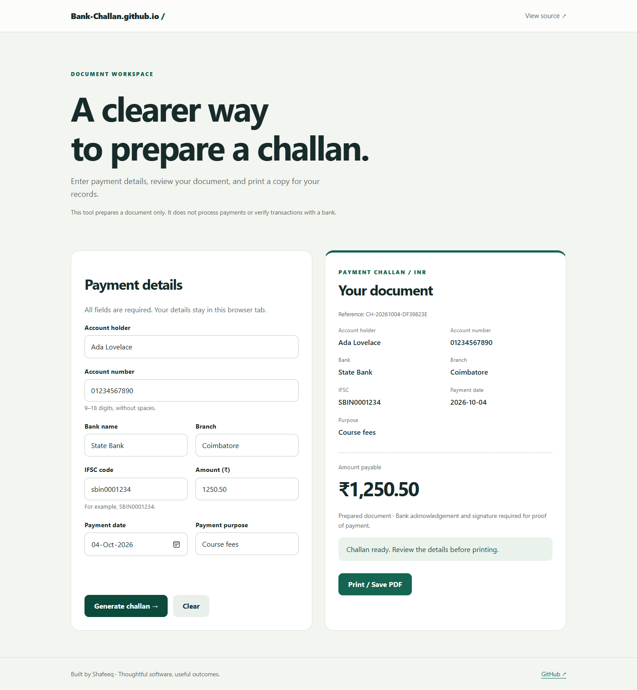

# Bank-Challan.github.io

A responsive bank challan generator with validated Indian account details, safe text rendering, and print-ready output.

## Run locally

```bash
python -m http.server 8000
```

Open http://localhost:8000. Run `npm test` with Node.js 22+ for validation checks.

## Features

- Account numbers preserve leading zeros; IFSC codes are normalized.
- Amounts accept up to two decimal places.
- Details remain in memory and are never sent to a server.
- Editing a field invalidates the preview to prevent printing stale data.
- Print or save as PDF through the browser’s print dialog.

This is a document preparation tool, not a payment gateway or bank-verified receipt. The original mock login was removed because a static page cannot securely authenticate users.

## Development

Changes are checked by GitHub Actions. Keep credentials in environment variables and never commit `.env`, local databases, or build output.

## Preview



Local screenshot; transaction and registration fields use sample data.
